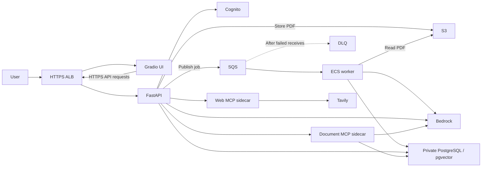

# Academic Intelligence Platform — Infrastructure

[](https://github.com/MP-30/academic-intelligence-platform-terraform/actions/workflows/terraform-plan.yml)
[](https://developer.hashicorp.com/terraform)

Terraform configuration for the AWS deployment of the [Academic Intelligence Platform](https://github.com/MP-30/Academic-Intelligence-Platform), a PDF question-answering application using Bedrock, pgvector, and MCP tools.

[Live UI](https://ai.adityalive.tech) · [Application source and local setup](https://github.com/MP-30/Academic-Intelligence-Platform)

## Architecture



The API and both MCP sidecars share an ECS task and communicate over localhost. Tasks use public subnets and public IPs for outbound access. Security groups allow API and UI ingress from the ALB. RDS uses private subnets and accepts application traffic from the API and worker security groups.

## Provisioned components

| Component | Configuration |
|---|---|
| VPC | Two public and two private subnets, Internet Gateway, S3 Gateway endpoint |
| PostgreSQL | RDS PostgreSQL 18.1, `db.t3.micro` by default, encrypted storage, private networking |
| S3 | Versioned PDF bucket with public access blocked |
| SQS | Main ingestion queue and DLQ, 300-second visibility, 20-second long polling, redrive after five receives |
| ECR | Shared application image repository, scan on push, five-image retention |
| ECS API | API, document MCP, and web MCP containers; 0.5 vCPU and 1 GiB per task |
| ECS worker | Optional service; 0.25 vCPU and 512 MiB per task |
| ECS UI | Gradio; 0.25 vCPU and 512 MiB per task |
| ALB and ACM | HTTPS, host routing for UI/API, HTTP redirect, DNS-validated certificate |
| Cognito | Email-based users, password authentication, 60-minute ID/access tokens |
| IAM | ECS execution/task roles and a runtime policy attached to an existing development IAM user |
| CloudWatch | API, worker, and UI log groups with seven-day retention |

DNS records, the state bucket, the development IAM user, and GitHub OIDC roles are operator-managed prerequisites. This repository outputs DNS values for manual entry at your DNS provider.

## Prerequisites

- Terraform **1.10+** for the S3 backend's `use_lockfile` setting. The provider configuration currently declares a broader `>= 1.6` minimum.
- AWS CLI, Docker with Buildx, Git, and credentials that can provision the resources
- A configured AWS profile, named `terraform-ai` in these examples
- A domain with permission to add certificate-validation and application CNAME records
- An existing IAM user matching `bedrock_dev_user`; the configuration attaches S3/SQS permissions to it
- Bedrock model access in `us-east-1` and a Tavily API key
- The application repository checked out alongside this repository

## Configure Terraform

```bash
git clone https://github.com/MP-30/academic-intelligence-platform-terraform.git
cd academic-intelligence-platform-terraform
```

For an existing deployment, retain its state bucket, state key, workspace, and variable values. The following bootstrap steps create a new installation. Confirm the intended AWS account with `aws sts get-caller-identity` before provisioning.

Create the remote state bucket once. Choose a globally unique name and retain it for subsequent runs.

```bash
export AWS_PROFILE=terraform-ai
export AWS_DEFAULT_REGION=us-east-1
STATE_BUCKET="academic-rag-tfstate-$(date +%s)"

aws s3 mb "s3://$STATE_BUCKET"
aws s3api put-bucket-versioning --bucket "$STATE_BUCKET" \
  --versioning-configuration Status=Enabled
aws s3api put-public-access-block --bucket "$STATE_BUCKET" \
  --public-access-block-configuration \
  'BlockPublicAcls=true,IgnorePublicAcls=true,BlockPublicPolicy=true,RestrictPublicBuckets=true'
```

Edit `backend.tf` to use that bucket and its region. Set the profile in your shell so backend initialization can authenticate. The provider's `aws_profile` variable configures provider access separately.

Create `terraform.tfvars` using this example for a new installation. Preserve existing secret values when updating an established deployment. The checked-in example omits some required settings.

```hcl
aws_region          = "us-east-1"
aws_profile         = "terraform-ai"
project             = "academic-rag"
bedrock_dev_user    = "bedrock-dev"
db_username         = "academic"
db_name             = "academic_db"
domain_name         = "your-domain.example"
ui_subdomain        = "ai"
api_subdomain       = "api"
cors_allowed_origin = "https://ai.your-domain.example"
ecs_worker_enabled  = false
```

Use Bash for these commands. Provide the required secret variables through your environment or a private variable file. The database password is interpolated into a connection URL by the current templates; a long random alphanumeric password avoids URL parsing problems with reserved characters.

```bash
read -rsp "Database password: " TF_VAR_db_password; echo
export TF_VAR_db_password
read -rsp "Tavily API key: " TF_VAR_tavily_api_key; echo
export TF_VAR_tavily_api_key

terraform init
terraform fmt terraform.tfvars
terraform fmt -check -recursive
terraform validate
```

The current configuration stores database and Tavily values in Terraform state and ECS task environment definitions. Restrict access to state and task definitions. Saved plan files can contain these values too.

## First deployment

### Bootstrap the image repository and certificate

ECS needs a published image before its services can become healthy. For a first installation, bootstrap ECR and the ACM certificate so you can publish the image and validate DNS before creating the services.

```bash
umask 077
PLAN_DIR=$(mktemp -d)
terraform plan \
  -target=aws_ecr_repository.worker \
  -target=aws_acm_certificate.main \
  -out="$PLAN_DIR/bootstrap.tfplan"
terraform show "$PLAN_DIR/bootstrap.tfplan"
```

Review the proposed resources, account, and region before applying the saved plan. Applying a saved plan executes it without another confirmation.

```bash
terraform apply "$PLAN_DIR/bootstrap.tfplan"
```

Targeted plans are for this initial dependency bootstrap. Use full plans for subsequent changes.

Find the requested certificate in ACM in `us-east-1`, copy its DNS validation CNAMEs to your DNS provider, and wait for the certificate to show **Issued**. `acm.tf` waits for validation but does not create the DNS records.

Publish the application image using the ECR URL from Terraform.

```bash
ECR_REPO=$(terraform output -raw ecr_repository_url)
ECR_REGISTRY="${ECR_REPO%%/*}"
aws ecr get-login-password | docker login \
  --username AWS --password-stdin "$ECR_REGISTRY"
docker buildx build --platform linux/amd64 \
  --tag "$ECR_REPO:latest" --push ../Academic-Intelligence-Platform
```

### Create the remaining services

Set `ecs_worker_enabled  = true` in `terraform.tfvars`, then review and apply a full plan.

```bash
terraform plan -out="$PLAN_DIR/deploy.tfplan"
terraform show "$PLAN_DIR/deploy.tfplan"
```

Review the full plan before applying it. Keep `PLAN_DIR` in the same shell session used for bootstrap. Plan files are stored outside the repository because they can contain credentials.

```bash
terraform apply "$PLAN_DIR/deploy.tfplan"
terraform output subdomain_records
terraform output ui_url
terraform output api_url
```

Add the UI and API CNAMEs from `subdomain_records` at your DNS provider. Certificate-validation CNAMEs and application CNAMEs serve different purposes; retain both.

The worker entrypoint creates database extensions and runs Alembic migrations before processing jobs. During first startup, the API can become live before those migrations finish. Check the worker logs for successful migration and startup before testing uploads.

### Verify the application

1. Check the ECS API, worker, and UI services and both MCP sidecars.
2. Request `/health` on the API hostname.
3. Use `POST /auth/register` through the API docs at `/docs` to create a user, then log in through the UI.
4. Upload a text PDF, check for `READY`, search for a distinctive phrase, and ask a question about it.
5. Inspect the cited page and retrieved passages.

Useful commands for the default project name follow.

```bash
aws ecs describe-services --cluster academic-rag \
  --services academic-rag-api academic-rag-worker academic-rag-ui \
  --query 'services[].{name:serviceName,running:runningCount,pending:pendingCount}'
aws logs tail /ecs/academic-rag-worker --since 10m
aws logs tail /ecs/academic-rag-api --since 10m
```

The liveness endpoint returns a static response. A successful health check alone does not establish that ingestion or MCP document search works. The private RDS endpoint requires a private connection or tunnel for access from a laptop.

## GitHub Actions

The [Terraform Plan workflow](./.github/workflows/terraform-plan.yml) runs formatting, validation, and a plan on matching changes to `main` and pull requests. It posts the plan on pull requests. Applying infrastructure remains a manual operation.

Configure these repository secrets before using the workflow.

| Secret | Purpose |
|---|---|
| `AWS_TERRAFORM_PLAN_ROLE_ARN` | Existing OIDC role with state access, lock-file permissions, and permissions needed to refresh/plan resources |
| `TF_VAR_db_password` | Required database input |
| `TF_VAR_tavily_api_key` | Required Tavily input |

The workflow must receive the same nonsecret inputs used locally, including domain, project name, and `ecs_worker_enabled`. A local ignored `terraform.tfvars` is absent on a fresh GitHub runner, so configure matching workflow variables or a tracked file of nonsecret inputs. Otherwise CI uses defaults, including a disabled worker service.

The OIDC provider and trust policies must permit the intended repository and branch or pull-request context. This repository does not provision those GitHub roles. CI sets the provider profile to an empty string to use the OIDC credential chain.

The [application deploy workflow](https://github.com/MP-30/Academic-Intelligence-Platform/blob/main/.github/workflows/deploy.yml) builds and publishes `:latest`, redeploys selected ECS services, waits for stability, and checks API liveness. Its account, ECR URL, cluster, service names, and hostname are specific to the original deployment. Update them when deploying to your own account. Its `AWS_DEPLOY_ROLE_ARN` secret refers to another operator-managed OIDC role.

## Outputs and troubleshooting

Use `terraform output` for bucket/queue names, ECR URL, service names, Cognito IDs, ALB hostname, and DNS records. Sensitive database outputs require explicit access and include credentials.

| Symptom | Check |
|---|---|
| Backend access or lock error | State bucket name/region, AWS credentials, and S3 object/lock permissions |
| ACM validation waits | Validation CNAMEs at the authoritative DNS provider |
| ECS image pull fails | ECR contains `latest`, image architecture is amd64, execution role and network access |
| PDF remains pending | Worker enabled and running, SQS/DLQ state, worker database and Bedrock errors |
| Chat misses an uploaded PDF | Ingestion status, Search tab results, document MCP logs, same user/workspace |
| Local database connection fails | RDS is private; use a local database or private network connection |

## Deployment limits and recovery

The checked-in configuration uses a single RDS instance, zero automated backup retention, `skip_final_snapshot = true`, and disabled deletion protection. The versioned document bucket has `force_destroy = true`. Review those settings and establish backups before depending on stored data.

The ECS image tag is mutable. MCP sidecars are nonessential containers, and the deployment health check does not exercise them. Immutable releases, retrieval readiness checks, rollback, and CloudWatch alarms remain improvements to implement.

## Cost

Costs depend on task runtime, ALB usage, database billing, storage/log retention, and Bedrock tokens including evals. Public subnet tasks and an S3 Gateway endpoint support the current deployment without a NAT gateway. Use dated AWS Cost Explorer figures for your account; the application README's historical estimate includes Bedrock and eval usage.
